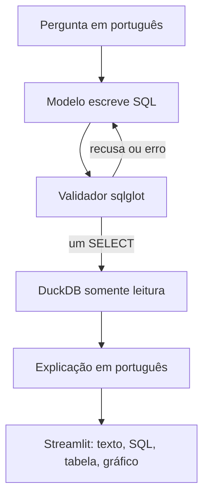
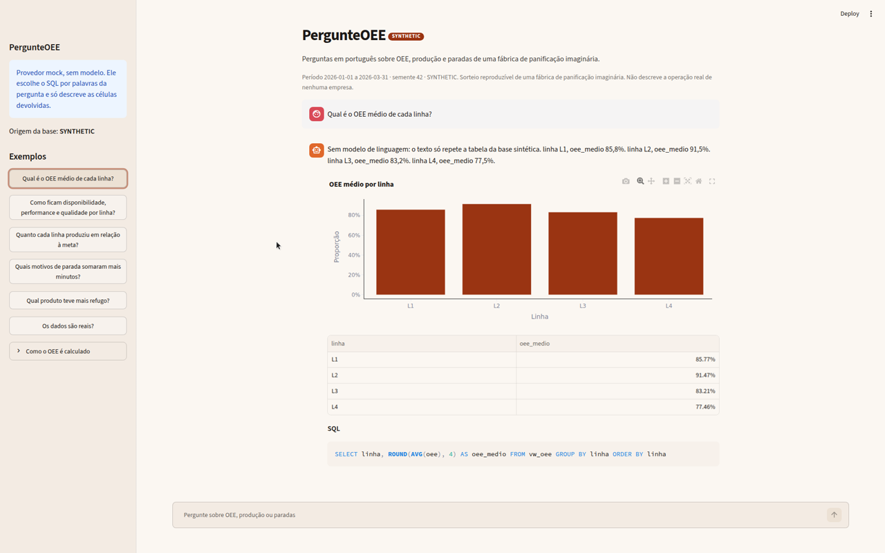

# PergunteOEE

Agente que responde perguntas em português sobre produção industrial: OEE, produção versus meta e paradas de linha.

Projeto de portfólio de João Vitor Sampaio (Rio de Janeiro). A motivação é o acompanhamento desses indicadores em fábrica de panificação. A base deste repositório é sintética. Nenhum número daqui saiu de um sistema real, e o texto não cita resultado de fábrica nenhuma.

## O problema

No dia a dia da produção, a pergunta muda: qual linha ficou abaixo da meta, qual turno tem o pior OEE, qual motivo de parada consumiu mais tempo. Um painel cobre os cortes que alguém desenhou antes. Aqui o caminho é outro. A pessoa pergunta em português, um modelo propõe SQL, um validador só deixa passar uma consulta de leitura, o DuckDB executa e a tela devolve a explicação, a tabela, o SQL e, quando a forma do resultado ajuda, um gráfico.

## Arquitetura



Há no máximo uma nova tentativa. O erro do validador ou do DuckDB volta para o modelo. A execução usa o SQL reescrito pelo parser, não a string original. A conexão abre em leitura e com `enable_external_access` desligado, então um SELECT não grava na base e não lê arquivo externo.

O gráfico não é escolhido pelo modelo. Uma regra olha a tabela: série temporal vira linha, uma categoria com até quatro medidas vira barra, e um número solto fica sem gráfico. O eixo de OEE começa em zero.

O provedor de modelo é uma interface pequena:

- `mock` é determinístico. Não chama rede e não é um modelo. O CI usa este caminho.
- `openai` fala com qualquer endpoint compatível com a API de chat da OpenAI. Serve para Ollama, LM Studio, o servidor do llama.cpp ou uma API hospedada.

## Dados sintéticos

O gerador usa uma semente fixa (padrão 42) e grava a marca `origem = SYNTHETIC` na tabela `metadados`. O aplicativo recusa um arquivo sem essa marca. O período padrão é de 90 dias, de 2026-01-01 a 2026-03-31.

| Linha | O que fabrica | Capacidade nominal | Calendário |
| --- | --- | --- | --- |
| L1 | Pão de forma tradicional e integral | 1200 un/h | Três turnos, inclusive domingo |
| L2 | Pão de hambúrguer e pão de hot dog | 2400 un/h | Três turnos, inclusive domingo |
| L3 | Bisnaguinha e pão sovado | 1800 un/h | Três turnos, inclusive domingo |
| L4 | Bolo inglês e bolo de cenoura | 600 un/h | Sem turno 3 e sem domingo |

Turnos de 480 minutos: 1 manhã (06:00-14:00), 2 tarde (14:00-22:00), 3 noite (22:00-06:00). Cada parada nasce e termina dentro de um turno. A view atribui a parada ao turno em que ela começa.

Tabelas: `producao` (data, turno, linha, produto, produzido, meta, refugo), `paradas` (inicio, fim, linha, motivo, categoria `planejada` ou `nao_planejada`), `linhas` e a view `vw_oee`.

Fórmula da view, no grão data, turno e linha:

- Tempo planejado = 480 minutos menos as paradas planejadas.
- Tempo operando = tempo planejado menos as paradas não planejadas.
- Disponibilidade = tempo operando / tempo planejado. Parada planejada não reduz a disponibilidade.
- Performance = (produzido + refugo) / (capacidade nominal por hora vezes o tempo operando em horas).
- Qualidade = produzido / (produzido + refugo).
- OEE = disponibilidade vezes performance vezes qualidade.
- Se o tempo operando é zero, o OEE fica zero.

A capacidade nominal é da linha, não de cada produto. O ritmo sorteado não é o mesmo nas quatro linhas: L2 fica mais estável e L4 rende menos, com um pouco mais de refugo. Isso é regra do gerador, não medição de fábrica.

`make data` ou a primeira abertura do aplicativo gera `data/pergunteoee.duckdb`. Esse arquivo não entra no git.

## Como executar

Python 3.11 ou mais novo. O CI usa 3.12. [uv](https://docs.astral.sh/uv/) instala as dependências a partir do `uv.lock`.

```bash
uv sync --all-groups
uv run streamlit run src/pergunteoee/app/streamlit_app.py
```

Sem `OPENAI_BASE_URL` e sem `OPENAI_MODEL`, a tela sobe no provedor mock. As perguntas da barra lateral funcionam offline.

Para um modelo local, copie `.env.example` para `.env` e preencha o nome do modelo que já estiver carregado. O arquivo `.env` não substitui variável que já exista no ambiente. A RX 9070 XT tem 16 GB. Um modelo quantizado em torno de 7B a 14B costuma caber, conforme a quantização e o contexto. Este repositório não escolhe o modelo e não publica acurácia.

```bash
LLM_PROVIDER=openai
OPENAI_BASE_URL=http://127.0.0.1:11434/v1
OPENAI_API_KEY=ollama
OPENAI_MODEL=nome-do-modelo-carregado
```

A mesma variável `OPENAI_BASE_URL` aponta para o LM Studio (`http://127.0.0.1:1234/v1`), para o llama.cpp (`http://127.0.0.1:8080/v1`) ou para uma API hospedada. A chave de uma API hospedada fica só no ambiente.

Outros comandos, também no `Makefile`:

```bash
make data    # gera a base de novo
make test    # pytest
make lint    # ruff
make eval    # avaliação com o provider mock
make check   # lint, teste e eval
make app     # Streamlit
```

Imagem opcional, já em modo mock:

```bash
docker build -t pergunteoee .
docker run --rm -p 8501:8501 pergunteoee
```

## Perguntas de exemplo

- Qual é o OEE médio de cada linha?
- Como ficam disponibilidade, performance e qualidade por linha?
- Quanto cada linha produziu em relação à meta?
- Quais motivos de parada somaram mais minutos?
- Qual produto teve mais refugo?
- Os dados são reais?

## Captura

Execução real da interface com o provedor mock, sem modelo de linguagem. O gráfico, a tabela e o SQL saem da consulta no DuckDB. O parágrafo só repete as células e avisa isso.



## Avaliação

Há 30 perguntas em português em `eval/perguntas.yaml`, cada uma com um SQL de referência. O script executa os dois SQL e compara os conjuntos de linhas. A ordem das linhas não importa. Números aceitam tolerância absoluta de 0,001. Nome de coluna não entra na conta: a comparação é pelo valor, na ordem das colunas.

```bash
uv run python -m pergunteoee.eval.run --provider openai --out eval/resultados.json
```

O GitHub Actions roda o mesmo script com `--provider mock`. Esse passo só verifica se a tubulação abre a base, percorre as 30 perguntas e grava o relatório. O número que aparecer no log do mock não é acurácia de modelo. A tabela abaixo fica vazia até uma execução com um modelo de verdade.

| Data | Modelo | Endpoint | Acurácia de execução | Perguntas | Observação |
| --- | --- | --- | --- | --- | --- |
|  |  |  |  | 30 | Preencher depois de uma execução real |

## Limitações

- SQL válido ainda pode responder a pergunta errada. O validador não entende a intenção.
- Só existe uma nova tentativa.
- O gráfico é uma heurística. Série com categoria e data ao mesmo tempo, ou mais de 40 linhas, fica sem figura.
- Parada que atravessasse dois turnos seria contada no turno do início. O gerador não cria esse caso.
- Não há microparada, operador, lote de matéria-prima nem custo.
- O sorteio é mais regular do que uma fábrica real.
- O mock não é um modelo. A explicação de um modelo real pode ir além da tabela, mesmo com o prompt pedindo o contrário. O número confiável é o da tabela executada.
- A aplicação não tem autenticação. A ideia é rodar na máquina local.
- Não há, neste README, acurácia medida com um modelo.

## English summary

PergunteOEE is a Portuguese text-to-SQL agent over a seeded synthetic bakery factory in DuckDB. It answers questions about OEE, output versus target, and line stoppages. A sqlglot validator allows one read-only SELECT, then DuckDB runs it and Streamlit shows the explanation, the SQL, the table, and a chart when the shape fits. An OpenAI-compatible provider targets a local server such as Ollama, LM Studio, or llama.cpp. A deterministic mock provider keeps tests and CI off the network. The evaluation set has 30 Brazilian Portuguese questions with gold SQL and compares result sets. The accuracy table above is intentionally blank until someone runs that eval with a real model. The data is synthetic.
